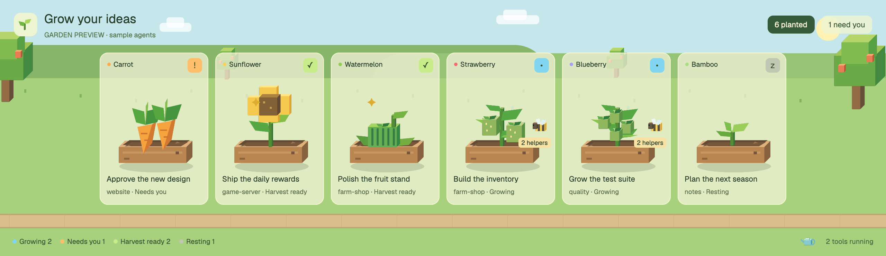

# Grow your ideas

An original blocky garden for Herdr: agents grow as crops in wooden beds, helpers are bees, and a tool-shed shell sits below the workspace. The art takes inspiration from the friendly gardening style of Roblox's Grow a Garden. It is original SVG artwork, not extracted game assets or an official Roblox product.

## What you see

A pale-blue sky, chunky orchard trees, a green lawn and a wooden path frame the planting beds. The header says **Grow your ideas**. Plants have names, task summaries, space labels and status badges. The lower toolbar contains spaces, tabs, settings, panel and agent buttons. Dark forest-green terminals remain readable below the bright garden.

Eight crops: strawberry, carrot, tomato, corn, blueberry, sunflower, watermelon and bamboo. Each has seedling, growing and ripe art. The selected crop is stable for a terminal address.

## How it behaves

- Working agents have growing plants, a blue badge and animated water droplets.
- Agents needing input have ripe plants and an orange **!** badge.
- Completed agents have ripe crops, **Harvest ready**, a green check and a gold sparkle.
- Idle agents rest as seedlings.
- Click a plant to focus its pane, or peek at it if it has no pane.
- Herdr child terminals appear as helper bees. The counter covers live children, not agents hidden inside another application's own process.
- Plants needing attention come first. Pagination keeps every plant reachable as the window narrows. The header can filter to agents needing input.
- Without agents, the scene shows decorative crops and an invitation to start one. Decorative crops are not live agents.
- The bottom shell is named `garden-shell` and kept by Herdr core. Switching layouts keeps it running. **Project folder**, **Clear**, and **Restart** act on that shell.

## Built from

- `layouts/garden.json`: garden scene (370px, resizable 300–600), toolbar, active tab with pane headers, bottom shell.
- `mods/garden-patch`: scene and question summaries; `model.js` holds crop/state/focus/page calculations. `tools/art.py` generates all thirty original SVG assets with Python's standard library.
- `mods/garden-bar`: space/tab navigation, split/agent controls and bottom-shell management. Uses Herdr's shipped `pane` mod for pane headers.
- `garden-keys.json`: layout-scoped shortcuts. The original NiuMa shortcuts and mods remain separate.
- `install_garden.py`: additive installation with preflight name/key checks and a backup of the prior key file.

The scene reads agent screens through `hc read` to obtain the latest question. It does not read Claude/Codex session logs. The bar uses `knownAgents`, `herdr-app do`, `hc run` and `hc send` to open panels and run user-selected commands, and `terminal.kill` only for the shell's Restart action. It contains no update downloader, analytics or network requests. The original NiuMa files retain their own behavior.

## Watch out

Requires an initialized Herdr app, Python 3 to install or regenerate art, and `hc` / `herdr-app` on PATH. Shortcuts use macOS key names. Agent buttons use Herdr's configured agent commands; an incompatible installed CLI or flags must be corrected in Herdr's `programs.json`. This layout does not change those commands globally.

Question summaries are best effort: terminal wrapping and agent prompt formats vary. No token/cost estimates or shell exit-code hook are added. Plants represent current status, not measured task progress. There is no crop economy, inventory, harvesting mechanic, or imported game account data.

`props: {"demo": true}` on the garden-patch block shows six labeled sample agents and helpers. Preview plants do not focus real terminals. Remove the prop for live agents.

## Done when

Run `python3 -m unittest discover -s tests -v` (Python 3 and Node required for checks), check both mods with `herdr-app check`, then switch to `garden` and inspect it live. Verify normal and compact scene sizes, all four statuses in demo mode, pagination, and the bottom shell. No paid agent needs to be started for the preview.
