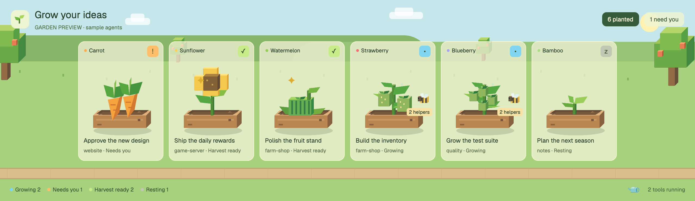

# Garden — grow your ideas

A Grow a Garden-inspired variant of [NiuMa by limbov8](https://github.com/limbov8/herdr-layout-niuma), with **original blocky garden art**: crops for agents, bees for helpers, wooden planting beds and a tool-shed shell. This fork does not include extracted Roblox assets or claim affiliation with Roblox or Grow a Garden.



## Install Garden

Launch Herdr once so `~/.config/herdr-app` exists, then run from this repository:

```sh
python3 install_garden.py
herdr-app check ~/.config/herdr-app/mods/garden-patch
herdr-app check ~/.config/herdr-app/mods/garden-bar
herdr-app do layout.switch '{"name":"garden"}'
```

The installer adds only Garden's files and keys, backs up `keys.json`, and refuses existing Garden names or conflicting bindings. It leaves NiuMa available. It does not edit your shell startup files. To use a nondefault Herdr home, pass `--home /path/to/home`.

Click an agent button to start planting. Working agents grow, blocked agents show **!**, completed agents are **Harvest ready**, and idle agents become seedlings. Click a plant to return to its terminal.

| Key | Action |
|---|---|
| ⌘T | New panel |
| ⌘⇧T | New panel with the first installed agent |
| ⌘W | Close focused panel |
| ⌘N | New space |
| ⌘1–9 | Switch spaces |
| ⇧⌘[ / ⇧⌘] | Previous / next space |
| Ctrl+Shift+L | Switch layouts |

Garden runs local Herdr commands to read agent screens and manage panels/the shell. It adds no network requests or session-log scanning. Agent launch commands come from Herdr's configuration; incompatible CLI flags can be adjusted in `programs.json`.

See [GARDEN-RECIPE.md](GARDEN-RECIPE.md) for behavior, art provenance and limitations. Regenerate the original artwork with `python3 mods/garden-patch/tools/art.py`. Development checks: `python3 -m unittest discover -s tests -v` (Node is also needed for the pure JavaScript model checks).

---

The original NiuMa layout and its documentation follow.

# NiuMa — a Herdr layout

Your coding agents graze in a pixel-art pasture: horses, cows, a bull, an ox, a water
buffalo, a bison and a rare unicorn, plus a Christmas moose in November and December (twenty-two breeds) that graze, drink, wait with a red `!` or lie down
when they're done, cast shadows from the sun, and rear, buck, hop or moo when clicked; sub-agents are rabbits,
squirrels and hedgehogs; plain terminals are campfires, cooking pots and magic crystals
that burn while a command runs. Your spaces are pills in the bar under the pasture, panels
sit side by side across the full width (no sidebar), and a shell runs along the bottom.


| Evening | Night |
|---|---|
|  |  |

⌃-click an animal to turn it round, and ⇧⌃-drag an animal or terminal object to move it. Click the sun to change the time of day. One new agent in ten or so arrives as a unicorn. In November and December, about one in five arrives as a Christmas moose.

See [RECIPE.md](RECIPE.md) for everything it shows and does, and how it's built.

## Install

### Recommended: tell your agent

In a Herdr terminal, ask your coding agent (Claude Code, Codex, …):

```
Read ~/.config/herdr-app/AGENTS.md, then add this layout: https://github.com/limbov8/herdr-layout-niuma/tree/main
```

It copies the layout and mods without overwriting yours, merges the keys, checks the mods
and switches to the layout. It should tell you first that the mods run `hc` (see Good to
know), and it may ask before adding the optional zsh hook.

### Manually

1. Copy into your Herdr home (don't overwrite anything of yours; rename if a name is taken):

   | From this repo | To |
   |---|---|
   | `layouts/niu-ma.json`, `layouts/niu-ma.svg` | `~/.config/herdr-app/layouts/` |
   | `mods/niu-ma-pasture/` | `~/.config/herdr-app/mods/` |
   | `mods/niu-ma-bar/` | `~/.config/herdr-app/mods/` |

2. Merge `keys.json`'s `layout:niu-ma` section into your `~/.config/herdr-app/keys.json`
   (`⌘T` adds a side-by-side panel, `⌘⇧T` one with your first installed agent, `⌘W`
   closes just the focused panel, `⌘N` makes a new space, `⌘1`–`⌘9` switch space,
   `⇧⌘[` / `⇧⌘]` previous / next space; only in this layout, and changeable in ⚙).

3. Optional, for exit codes on terminal objects (zsh): add to `~/.zshrc`

   ```sh
   [[ -n $HC_TERMINAL_ID ]] && source ~/.config/herdr-app/mods/niu-ma-pasture/shell/niu-ma.zsh
   ```

4. Check and switch:

   ```sh
   for m in niu-ma-pasture niu-ma-bar; do herdr-app check ~/.config/herdr-app/mods/$m; done
   herdr-app do layout.switch '{"name":"niu-ma"}'
   ```

## Good to know

- The bar's **+** asks which machine a new space goes on (this computer or one from
  `hc machine ls`, or Add machine…); ⌘N makes one on the current space's machine.
- There's no sidebar: switch spaces with the bar's pills; rename, reorder and worktrees are
  in the command palette (`⌘⇧P`). Herdr's `⌘B` (toggle sidebar) does nothing useful here.
- It runs `hc` locally: `hc read` on agents' screens (questions and Claude Code
  sub-agents), `hc run` / `hc send` for the bottom shell and for typing agent commands into
  a new panel (with `herdr-app do pane.split`), and `hc label` from the optional zsh hook. No network access apart from the update check and Upgrade (below), no files outside Herdr's folder.
- The ⚙ in the bar sets the command that starts Claude Code and Codex (e.g.
  `declawd --yolo`), shown next to Herdr's default. It's saved as their `run` in
  `~/.config/herdr-app/programs.json`, so Herdr's own menus use it too. Its **Start agents
  in a shell** switch (on by default) makes the bar's agent buttons and `⌘⇧T` type the
  command into a shell panel, so the agent gets your `~/.zshrc` (e.g. env for Claude on
  Vertex or Bedrock); Herdr's own menus start agents without it. **Show the shell at the
  bottom** hides or shows the bottom shell (it keeps running while hidden).
- **Updates.** The bar asks GitHub for the latest `VERSION` every 6 hours and
  shows an **Update** button next to ⚙ when there's a newer NiuMa. It and ⚙
  show the installed and latest version and what changed (`CHANGELOG.md`); **Upgrade**
  does the manual install for you: downloads `main`, keeps your previous files in
  `~/.config/herdr-app/.niu-ma-backup/`, copies the layout and both mods over, adds new
  `layout:niu-ma` keys without replacing yours, and runs `herdr-app check`. It assumes the
  default names (`niu-ma`, `niu-ma-pasture`, `niu-ma-bar`). This is the only network
  access: `raw.githubusercontent.com` and `codeload.github.com`.
- **Sponsor.** ⚙ has buttons for [GitHub Sponsors](https://github.com/sponsors/limbov8) and
  [Buy Me a Coffee](https://buymeacoffee.com/limbov8).
- **Tokens and cost.** Claude Code and Codex agents' name tags show `1.2M tok · $3.4 / $8.0`
  (tokens this session without cache reads · estimated API $ today / whole session). It
  reads `~/.claude/sessions`, `~/.claude/projects` and `~/.codex/sessions` locally with
  `python3` (`mods/niu-ma-pasture/tools/usage.py`), once a minute; nothing leaves the
  machine. Turn it off with **Show tokens and cost** in ⚙.
- **Machines that need a login** (after the host was down) get `hc machine login <name>`
  opened for you in a Log in tab, so you only type the password or code. Switch: ⚙.
- **Feedback.** ⚙'s Feedback button opens a [new issue](https://github.com/limbov8/herdr-layout-niuma/issues/new).
- Click the sun (or moon) to change the pasture's sky: auto (follows the clock), day,
  evening, night. It's separate from the app's theme, so a dark theme can keep the sun.
- Put `"props": { "demo": true }` on the pasture block to see made-up agents and terminals
  in every state (that's how `preview.png` and `previews/` were taken); `"sky": "evening"`
  pins the sky.
- The sprites are generated: `python3 mods/niu-ma-pasture/tools/sprites.py`.
